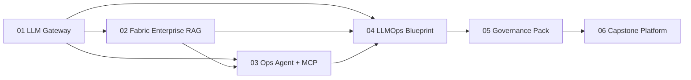

# AI Architect Portfolio

Six systems, each shipped with the architecture pack around it: C4 diagrams,
ADRs, NFR table, eval results, cost model, threat model and IaC.



| # | Project | Status |
|---|---------|--------|
| 01 | [LLM Gateway](projects/01-llm-gateway) | Day 20 |
| 02 | [Fabric Enterprise RAG](projects/02-fabric-enterprise-rag) | Day 49 |
| 03 | [Ops Agent + MCP](projects/03-ops-agent-mcp) | Day 70 |
| 04 | [LLMOps Blueprint](projects/04-llmops-blueprint) | Day 90 |
| 05 | [AI Governance Pack](projects/05-ai-governance-pack) | Day 105 |
| 06 | [Capstone Platform](projects/06-capstone-regulated-ai-platform) | Day 111 |

## Conventions
- Every decision gets an ADR in `docs/adr` (copy `0000-template.md`).
- Every project README answers: problem, architecture, results, how to run.
- Definition of done: runs from a clean clone, README explains the why, one ADR recorded.

## Dev setup
```bash
make setup   # installs pre-commit hooks
make check   # runs all hooks on all files
```
